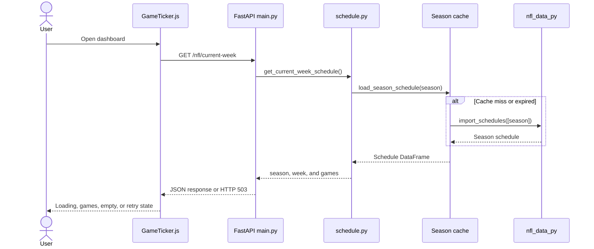
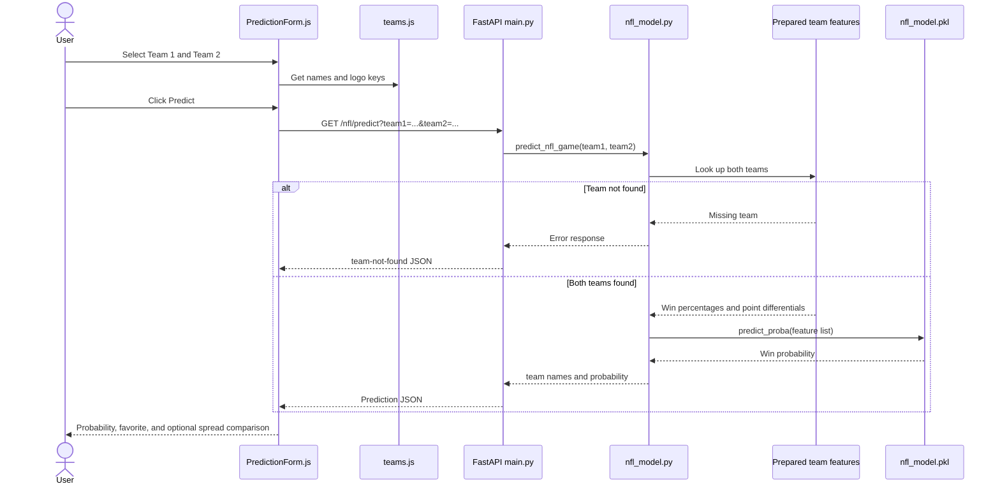

# NFL Sports Analytics Architecture

The diagram below shows how the React frontend, FastAPI backend, model, analytics
code, and external data sources are connected.

```mermaid
flowchart LR
    Browser[Browser user]

    subgraph Frontend["React frontend - frontend/src"]
        Root[index.js<br/>React root]
        App[App.js<br/>Dashboard layout]
        Ticker[GameTicker.js<br/>Schedule UI]
        Prediction[PredictionForm.js<br/>Team selectors and results]
        Teams[teams.js<br/>Team names and ESPN logo keys]
        Spread[Vegas spread comparison<br/>Frontend-only state]
        ESPN[ESPN team-logo CDN]
    end

    subgraph Backend["FastAPI backend - backend"]
        Main[main.py<br/>App and CORS middleware]
        ScheduleRoute[GET /nfl/current-week]
        PredictRoute[GET /nfl/predict]
        Schedule[schedule.py<br/>Season lookup and 6-hour cache]
        ModelLogic[nfl_model.py<br/>Feature lookup and prediction]
    end

    subgraph Analytics["Analytics and model"]
        Loader[analytics/nfl_data_loader.py<br/>2023 schedule and features]
        Model[analytics/nfl_model.pkl<br/>Trained classifier]
        NFLverse[nfl_data_py / nflverse]
    end

    Browser -->|opens| Root
    Root -->|renders| App
    App --> Ticker
    App --> Prediction

    Prediction -->|selects teams| Teams
    Teams -->|loads logos| ESPN
    Prediction -->|optional spread| Spread
    Spread -->|compares with probability| Prediction

    Ticker -->|GET /nfl/current-week| Main
    Prediction -->|GET /nfl/predict with team parameters| Main
    Main --> ScheduleRoute
    Main --> PredictRoute

    ScheduleRoute --> Schedule
    Schedule -->|cache miss or expiry| NFLverse
    Schedule -->|season, week, games| ScheduleRoute
    ScheduleRoute -->|JSON or HTTP 503| Ticker

    PredictRoute --> ModelLogic
    ModelLogic -->|load and prepare games| Loader
    Loader -->|import_schedules([2023])| NFLverse
    ModelLogic -->|predict_proba(features)| Model
    ModelLogic -->|team names and probability| PredictRoute
    PredictRoute -->|prediction JSON or error JSON| Prediction
```

## Request flows

### Load the current-week schedule



### Predict a game


